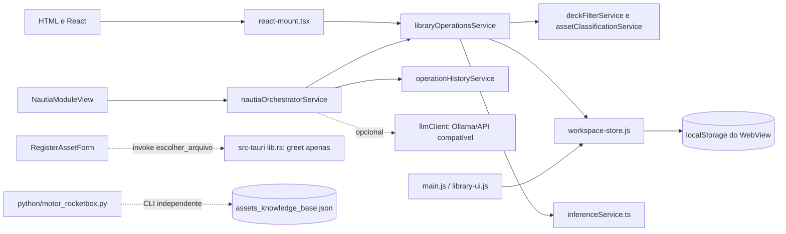

# OCSIS RocketBox — Auditoria funcional e plano de implementação

Auditoria estática e execução de validações realizada em 15/11/2026. O escopo foi o código presente no projeto, os testes automatizados e os builds locais. Não foram alterados registros, preferências nem arquivos de assets do usuário.

## Resumo executivo

O RocketBox já tem um núcleo frontend utilizável: cadastro de metadados, biblioteca de registros, pastas virtuais, etiquetas, filtros, lixeira lógica, preferências e um motor local de operações para a Nautia. O armazenamento principal é `localStorage`; portanto, é persistente por origem/perfil do WebView, mas não é um banco transacional compartilhado entre instalações e não guarda os arquivos.

As lacunas mais importantes são a ausência do comando Rust `escolher_arquivo` que o formulário invoca no modo Tauri, a falta de seleção de diretórios nativa e de inspeção real do conteúdo dos assets, a separação do motor especialista Python em relação ao motor determinístico TypeScript usado pela Nautia, e a ausência de validação robusta do JSON do histórico/conversas. A ponte React ↔ Tauri consiste em chamadas frontend pontuais; o serviço central da biblioteca é TypeScript e não atravessa IPC para persistir.

O estado geral não é “apenas visual”: a organização local de metadados funciona e os testes de domínio são extensos. Ao mesmo tempo, prévias e declarações de compatibilidade não devem ser confundidas com renderização 3D, inspeção técnica de bytes, verificação de existência de caminhos ou uso do motor Python.

## Matriz funcional

| Área | Arquivos e implementação real | Limitações / falhas | Estado |
|---|---|---|---|
| Registro de assets | `src/components/deck/RegisterAssetForm.tsx`, `src/services/assetIdentificationService.ts`, `src/services/deckFilterService.ts`, `src/react-mount.tsx`, `src/services/libraryOperationsService.ts`. Formulário cria metadados com nome, caminho, modalidade, categoria, software de origem/alvo, pasta e etiquetas. Identificação é feita por extensão/nome e regras locais. | Não copia nem move o arquivo. Caminho manual não é validado contra o disco. O formulário permite referência a caminho inexistente. Identificação por extensão é heurística, não leitura do formato. | Funcional para cadastro de metadados; inspeção física parcial/ausente. |
| Pacotes e projetos | Opções e validações no `RegisterAssetForm.tsx` e catálogo em `assetIdentificationService.ts`/`deckFilterService.ts`. `.uproject`, diretório Unity, `.blend` e pacotes têm classificação/modalidade. | A auditoria encontrou seleção de arquivo, mas não seletor de diretório funcional para projeto Unity. A estrutura do projeto não é percorrida e pacote não é extraído. | Parcial. |
| Seleção de arquivo | `RegisterAssetForm.tsx` usa `<input type=file>` no navegador e tenta `invoke('escolher_arquivo')` no Tauri. A seleção browser permite arquivos e preview local de imagem por `URL.createObjectURL`. | `src-tauri/src/lib.rs` só registra `greet`; `escolher_arquivo` não existe no handler. No Tauri o erro é capturado e o usuário recebe alternativa de digitar o caminho. Não há comando para escolher diretório. Drag and drop de arquivo externo não é suportado segundo README. | Parcial no browser; quebrado como seletor nativo no Tauri. |
| Persistência do workspace | `src/workspace-store.js` usa `ocsis.rocketbox.workspace.v1`, snapshots, validação, escrita única via `setItem`, bloqueio após leitura corrompida e detecção de divergência entre janelas. | `localStorage` é por origem/perfil do WebView. Não há backup automático do workspace, banco externo ou sincronização. Códigos de preferência e workspace permanecem no WebView, não em Rust. | Funcional localmente, com limites de escala e recuperação. |
| Biblioteca e pastas | `src/library-ui.js`, `src/components/deck/DeckFilteredView.tsx`, `src/services/libraryOperationsService.ts`, `src/workspace-store.js`. CRUD de metadados, hierarquia virtual, navegação, organização e detalhes. | Pastas não correspondem a diretórios físicos. A ordenação/reordenação visual não movimenta arquivos. | Funcional para biblioteca lógica. |
| Etiquetas | `deckFilterService.ts`, `tagPickerLogic.ts`, `TagPicker.tsx`, `FolderTagFilterBar.tsx`, `libraryOperationsService.ts`. Catálogos de etiquetas de asset e pasta são separados; associação, renomeação, remoção, classificação sugerida e busca operam sobre registros. | Etiquetas são metadados locais; não são gravadas em arquivos nem sincronizadas. A criação de pasta possui regra de etiqueta obrigatória conforme testes atuais. | Funcional para metadados. |
| Pesquisa e filtros | `deckFilterService.ts`, `deckFilterService`/`deckFilterService.ts` e `src/state/useDeckFilters.ts`, componentes de filtros universais e `DeckFilteredView.tsx`. Critérios ALL/ANY, etiquetas de pasta/asset e filtros combinados. | A qualidade do resultado depende dos metadados cadastrados. Não há indexação do conteúdo físico nem busca full-text dentro de arquivos. | Funcional no conjunto de dados local. |
| Lixeira e restauração | `workspace-store.js`, `library-ui.js`, `libraryOperationsService.ts`, `docs/biblioteca-lixeira.md`. Exclusão lógica em lotes, restauração com resolução de conflito e purge apenas dos registros locais após confirmação. | A purga apaga metadados locais sem recuperar arquivo físico; arquivos externos são explicitamente preservados. Lixeira não é lixeira do sistema operacional. | Funcional para registros virtuais. |
| Histórico de operações | `operationHistoryService.ts`, `DeckFilteredView.tsx`, `NautiaModuleView.tsx`. Armazena até 100 operações em `ocsis.rocketbox.nautia.history.v1`, oferece desfazer quando existe descritor reversível. | `load()` aceita qualquer array parseável como `OperationHistoryEntry[]` sem validar esquema. Falha de quota é engolida e o histórico segue só em memória. Operações manuais executadas fora dos pontos integrados podem não gerar entrada. Undo composto pode reverter passos anteriores e falhar em um passo posterior sem rollback do lote. | Parcial, útil, mas não é trilha auditável confiável. |
| Asset Viewer | `src/index.html`, `RegisterAssetForm.tsx`, estilos em `studio.css`. A prévia de imagens usa URL temporária do navegador; outros formatos recebem painel informativo por modalidade. | Não há Three.js/Babylon/model-viewer nas dependências nem carregamento/rotação de modelos. Prévia nativa pode receber arquivo sem bytes (o Rust atual nem implementa o comando). Campos de geometria/canais são apresentação, não análise medida. | Parcial: imagem no browser; 3D ausente. |
| Motor de Inferência | `src/services/inferenceService.ts`, `assetClassificationService.ts`, `libraryOperationsService.ts`; motor separado em `python/motor_rocketbox.py` e `assets_knowledge_base.json`. TypeScript gera relatórios determinísticos estruturados e regras locais. Python consulta a base JSON e produz recomendações via stdout. | O fluxo TypeScript da Nautia não invoca Python. O Python não é registrado como comando Tauri; não foi encontrada chamada IPC para ele. A inferência TypeScript usa metadados declarados, não inspeciona bytes ou estrutura de projetos. Python cobre regras limitadas a formatos explícitos e retorna recomendação geral para o resto. | Funcional como regras determinísticas locais; integração Python e inspeção profunda ausentes. |
| Chat da Nautia | `NautiaModuleView.tsx`, `nautiaOrchestratorService.ts`, `NautiaChatThread.tsx`, `nautiaConversationStore.ts`. Conversa salva localmente, consulta determinística, plano de ação, quick actions e confirmação antes de executar plano mutável. | Persistência limita a 20 conversas e falhas/quebras de schema são convertidas em lista vazia sem aviso. Chat sem LLM usa parser/regras, não é conversa generativa aberta. Documentação do README está desatualizada ao dizer que não há chat/IA implementados. | Funcional determinístico, com escopo delimitado. |
| Integrações com LLM | `src/services/llmClient.ts` e `nautiaOrchestratorService.ts`. Provider `none`, Ollama e endpoint compatível com API OpenAI; saída JSON é convertida em lista de ferramentas permitidas. Chave pode ser enviada como Bearer. | Configuração começa em `none`; a chave/configuração do componente é estado de UI e não está ligada ao serviço versionado de preferências. Não há armazenamento seguro de segredo Tauri, teste de conexão independente, timeout explícito ou política de rede/CSP. Prompt contextual envia resumo da biblioteca ao endpoint configurado. Validar nome da ferramenta não valida completamente o formato/escopo dos argumentos. | Opcional e implementada em código; depende de configuração local e requer endurecimento antes de uso com mutações. |
| React ↔ Tauri/Rust | React monta via `src/react-mount.tsx`; `main.js` compartilha store, navegação, notificações e callbacks. Frontend usa `isTauri()` e `invoke()` no seletor. | `lib.rs` registra apenas `greet`. Capability concede `core:default` e opener. Não há comandos de filesystem, Python, metadados ou diálogo. O contrato Tauri prometido pelo formulário está ausente. | Ponte frontend React funcional; integração Rust mínima/incompleta. |
| Erros | Stores bloqueiam sobrescrita em caso de corrupção e escritas do workspace/preferências publicam estado após persistir. Formulário trata erro do seletor e validação. | Há capturas silenciosas em armazenamento de conversas/histórico e alguns fallbacks; usuário pode não saber que persistência falhou. O seletor nativo mascara a falta de comando com pedido de caminho manual. | Parcial, com boas proteções centrais e lacunas nos subsistemas. |
| Configurações | `preferences.ts`, `settings-ui.js`, `appearance.js`, `settings.css`. Preferências validadas, migração versionada, import/export de preferências, presets, persistência local e sync de storage event. | Exportação de preferências não é backup da biblioteca. Preferências são locais ao WebView. LLM não usa o store de preferências e portanto não persiste entre reinícios. | Funcional para preferências, separadas do workspace. |

## Arquitetura e serviços reutilizáveis

Reutilizar `workspace-store.js` como fonte de verdade imediata e `libraryOperationsService.ts` como porta única de mutação. A interface já passa essas operações para Convés e Nautia. `deckFilterService.ts` contém tipos e regras de identificação/filtros; `inferenceService.ts` fornece relatórios tipados; `operationHistoryService.ts` oferece trilha local e undo; `nautiaOrchestratorService.ts` faz interpretação, validação de plano e execução autorizada. Evitar criar uma segunda store ou duplicar regras de classificação.

Para acesso a disco, introduzir uma fronteira pequena e explícita no Tauri: comandos Rust para diálogo e leitura de metadados necessários, com validação de caminho e payload limitado. Separar seleção de caminho, inspeção de metadados e operações de leitura. Não conceder acesso amplo ao filesystem ao frontend. Preservar a execução do frontend no browser usando adaptador de capacidade com fallback claro.

## Problemas críticos e prioridades

1. **Seletor nativo quebrado:** chamada `invoke('escolher_arquivo')` não corresponde a comando Rust registrado. Reproduzível pelo código; `cargo check` não verifica nomes de comandos chamados dinamicamente do frontend.
2. **Histórico/conversas com integridade fraca:** arrays sem validação de esquema e falhas de gravação silenciosas podem produzir perda aparente ou dados inválidos.
3. **Rótulo “LLM pronta” não é teste de conexão:** status configurado pode indicar provider disponível sem verificação de rede; classificar como configurado até um health check real.
4. **Contratos do LLM permissivos:** allowlist valida nomes de ferramenta, mas não tipos/IDs/argumentos e limites de tamanho/quantidade em profundidade. Plano mutável deve permanecer em revisão explícita e ser revalidado imediatamente antes de executar.
5. **Dois motores sem ponte:** Python e JSON de conhecimento não são usados pelo caminho de inferência TypeScript da Nautia. Definir se Python é legado experimental ou backend desejado antes de integrá-lo.
6. **Afirmações técnicas sem prova física:** compatibilidade é regra determinística sobre extensão/cadastro, não validação de arquivo, versão, dependência, escala, rig, resolução ou conteúdo.
7. **Documento de projeto fora de sincronia:** README descreve Nautia como futura e atribui 37 testes; a suíte corrente tem 62 testes e código de chat/plano/LLM opcional. Atualizar docs junto com as fases.

## Plano incremental

### Fase 1 — RocketBox Core

1. **Consolidar contrato de cadastro.** Adotar `libraryOperationsService.registerAsset` como caminho único; validar campos e caminhos de forma consistente, identificar duplicados sem ler conteúdo, exibir claramente “referência cadastrada” versus “arquivo verificado”.
2. **Seletor compatível com Tauri.** Implementar diálogo nativo via plugin/comando Tauri oficialmente suportado e registrar permissões mínimas; adicionar seleção de diretório para Unity. Não mover/copiar arquivos. No browser, manter `<input>` com capacidade equivalente.
3. **Persistência e backup do workspace.** Manter formato/migração compatíveis. Definir export/import separado da preferência, validação completa, recuperação e limites; documentar escopo local por perfil. Avaliar SQLite somente se houver requisitos concretos de volume/concorrência, sem migração prematura.
4. **Biblioteca e consultas.** Preservar services atuais, cobrir integração entre filtro e pesquisa geral e resolver semântica de busca no workspace. Evitar duplicar `filterAssets` e `runDeckFilters` sem contrato explícito.
5. **Etiquetas/pastas.** Manter catálogos relacionais existentes; ampliar casos de hierarquia, colisão e operações em lote através dos mesmos serviços.
6. **Lixeira e histórico.** Validar schemas ao ler; reportar falha de gravação. Tornar operações compostas atômicas ou desfazer com compensação segura. Garantir que todas as mutações do usuário sejam registradas.
7. **Resiliência.** Casos de quota, JSON malformado, duas janelas, reinício e dados antigos; backup e recuperação devem ser testados sem arquivos reais.

### Fase 2 — Motor de Inferência

1. Criar catálogo único de formatos e separar “identificação por extensão” de “inspeção realizada”.
2. Adicionar inspeção técnica limitada por formato, começando por formatos abertos (por exemplo glTF/GLB e imagens); produzir evidências com origem, versão e campos medidos.
3. Regras de compatibilidade versionadas e explicáveis, com testes por regra, entradas desconhecidas como “não verificado” e sem inferir compatibilidade a partir de uma extensão genérica.
4. Decidir destino de `motor_rocketbox.py`: adaptar como processo backend controlado com schema JSON, timeout e erros estruturados, ou manter como ferramenta de consulta independente documentada. Não manter dois resultados divergentes para a mesma operação.
5. Relatórios reproduzíveis: formato, regras executadas, fatos observados e ressalvas separados. Nenhum diagnóstico deve alegar leitura de conteúdo se apenas recebeu metadados.

### Fase 3 — NautIA Intelligence

1. Integrar chat a `libraryOperationsService` e ao histórico existente como camada de apresentação, evitando mutações paralelas.
2. Fechar schemas por ferramenta: tipos, enumerações, IDs existentes, limites de lotes e permissões por ator; limitar tamanho de prompt/resposta e tempo de rede.
3. Tratar saída do LLM como proposta não confiável. Mostrar escopo, itens e efeitos antes da confirmação; revalidar o estado antes de executar; registrar resultado e permitir undo quando aplicável.
4. Implementar persistência segura de configuração/secrets via mecanismo próprio de credenciais do sistema ou plugin compatível com Tauri. Nunca persistir chave em `localStorage`.
5. Adicionar health check explícito para Ollama/API compatível, timeout, cancelamento e estados “configurado”, “conectado” e “indisponível” distintos.
6. Manter modo determinístico sem LLM e comunicar limites; teste deve comprovar que provider `none` não faz chamada externa.

## Testes necessários

- **Unitários de domínio:** formato/categoria, modalidade asset/pacote/projeto, normalização e duplicidade de caminho, filtros ALL/ANY e hierarquia; regras do motor com evidência e casos desconhecidos.
- **Persistência:** migrações, falha de quota em workspace/preferences/history/conversations, JSON corrompido, limites, compatibilidade com dados legados e concorrência entre janelas.
- **Tauri IPC:** contrato do seletor, cancelamento, permissões mínimas, arquivo/diretório inexistente, caminho Unicode/espaços, erros e payload de preview limitado; teste de integração em Windows/WebView2.
- **Biblioteca/lixeira/histórico:** operações CRUD, undo simples e composto, undo parcialmente falho, árvore com itens em lotes distintos, nenhuma escrita em filesystem durante lixeira/purge de metadados.
- **LLM e ferramentas:** respostas malformadas, tool desconhecida, argumentos errados, IDs ausentes, prompt injection em metadados, timeout, provider indisponível e confirmação/cancelamento. Mock de rede para unitários; teste local opcional para Ollama.
- **Inspeção de arquivos:** fixtures pequenas e seguras por formato; arquivos truncados, malformados, grandes e extensões enganosas. Verificar que relatórios distinguem metadado declarado de medição real.
- **E2E:** Tauri em perfil isolado, registrar → reiniciar → pesquisar → mover pasta → restaurar → revisar histórico; preservar a UI existente e validar janela mínima.

## Verificações executadas e limites

- `npm test`: **62 passaram, 0 falharam**.
- `npm run build`: **passou** (TypeScript estrito e Vite). Vite reportou chunk JS de 515,76 kB acima do limite informativo de 500 kB.
- `cargo check --manifest-path src-tauri/Cargo.toml`: **passou**; isso valida o Rust compilado, mas não confirma que `invoke('escolher_arquivo')` tem comando correspondente.
- Não foram executados fluxos que apagam registros ou alteram arquivos físicos. A auditoria não adicionou dependências nem alterou a interface.
- O checkout disponível não expôs metadados Git na raiz informada (`git rev-parse` retornou “not a git repository”); portanto, não foi possível comparar a auditoria com histórico de commits ou alterações pendentes.

## Arquivos de referência

- Core: `src/workspace-store.js`, `src/services/libraryOperationsService.ts`, `src/services/deckFilterService.ts`, `src/react-mount.tsx`.
- Registro: `src/components/deck/RegisterAssetForm.tsx`, `src/services/assetIdentificationService.ts`.
- Inferência: `src/services/inferenceService.ts`, `src/services/assetClassificationService.ts`, `python/motor_rocketbox.py`, `assets_knowledge_base.json`.
- Nautia: `src/services/nautiaOrchestratorService.ts`, `src/services/llmClient.ts`, `src/services/operationHistoryService.ts`, `src/services/nautiaConversationStore.ts`, `src/components/nautia/NautiaModuleView.tsx`.
- Tauri: `src-tauri/src/lib.rs`, `src-tauri/tauri.conf.json`, `src-tauri/capabilities/default.json`.
- Preferências: `src/preferences.ts`, `src/settings-ui.js`.
